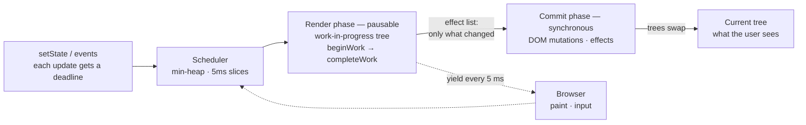

# RFS — React From Scratch

**React 16's internals — fiber, scheduler, renderer, event system — reimplemented from
the original source, to understand its design decisions from the inside.**

~17,000 lines of JavaScript · 42 Seoul team project · 2024 · **archived at the integration stage**

> **Abstract.** This project runs on one conviction: *the way to actually understand a
> large codebase is to rebuild its skeleton — the core loop, the phase boundaries, the
> contracts between them — until its design decisions become decisions you can defend.*
> The codebase chosen was React 16, read at the source level (`react-reconciler`,
> `scheduler`, the legacy `react-dom` event system) and rebuilt
> [file for file, phase for phase](#the-structural-mirror). Read this way, React turns
> out to be something more general than a UI library:
> [a call stack redesigned as data so it can be paused](#a-call-stack-you-can-pause),
> [a double-buffered tree that makes abandoning work free](#two-trees-one-truth),
> [a scheduler whose priorities are deadlines in milliseconds](#a-scheduler-in-userspace).
> Each section below names the principle, shows how React engineers it, and points at
> the file in this repo that rebuilds it. The project was
> [archived at the integration stage](#status-honest) — what is here is the anatomy,
> honest about where it stopped.

## The Machine, at a Glance

One update's life: it enters with a deadline, the render phase computes on the hidden
tree and may yield after any node, and commit pays only for what changed.



## What React 16 Turns Out To Be

### A call stack you can pause

Any computation that must share a thread with something more urgent hits the same wall:
recursion cannot be suspended, because its state lives in stack frames the language
owns. Fiber is React's answer — **the call stack rebuilt as an object graph**. Each
node carries `return` / `child` / `sibling` pointers, so "where am I in the tree" is
heap data, and the recursive walk becomes a `while` loop that can stop after any node
and resume later. This is the general move behind incremental GC, chunked parsers, and
time-sliced game loops: turn implicit control flow into explicit data, and scheduling
becomes possible at all.

*The entire concurrency story is one condition wide: `workLoopSync` and
`workLoopConcurrent` are the same loop, ± `&& !shouldYield()`
(`srcs/work/workloop.js`, `srcs/fiber/fiber.js`).*

### Two trees, one truth

Interruptible work is only safe if nothing observable happens until it finishes — the
same reason a renderer draws to a back buffer and a database writes to a shadow page.
Every fiber has an `alternate`: one tree is **current** (what the user sees), the other
is **work-in-progress**, and the render phase mutates only the hidden one. Abandoning a
half-finished render therefore costs nothing and undoes nothing; the commit phase, which
does touch the DOM, is uninterruptible *by construction*, and publishing a frame is a
pointer swap.

*`createWorkInProgress` in `srcs/fiber/fiber.js`; the synchronous mutation pass in
`srcs/work/commitWork.js`.*

### Pay for what changed, not for what exists

The commit phase never searches for work — by the time it runs, the answer to "what
changed?" already exists. During render, every fiber that needs a real-world change is
**stamped with an `effectTag`** (placement, update, deletion) and, as its parent
completes, **linked into one flat list** (`firstEffect` / `lastEffect` / `nextEffect`).
When the root completes, that list holds exactly the dirty fibers, in order. Commit
walks the list and nothing else: three changed nodes in a 10,000-node tree cost three
visits. This is the invoice every incremental system tries to write — dirty rectangles
in a renderer, changed-file sets in a build graph — collect the delta *while* you
compute, so applying it costs only the delta.

*Tagging in the phase files; list splicing in `completeUnitOfWork`, consumed by the
commit loop (`srcs/work/workloop.js`).*

### A scheduler in userspace

The browser hands you one thread and no preemption: whatever runs, runs to completion,
and paint and input wait behind it. So React ships the thing an OS would provide — a
**cooperative scheduler**, built in userland. Tasks sit in a min-heap keyed by
expiration; work runs in **5 ms slices**; between slices, control goes back to the
browser so it can paint, and the next slice is re-armed through a `MessageChannel`
(`setTimeout` is clamped to ~4 ms — the message port fires sooner and still sits below
paint). Priority is a **deadline, not a rank**: an interactive update must land within
150 ms, a normal one within 5,000 ms, rounded into 100 / 250 ms buckets so
near-simultaneous updates share a deadline and batch for free. And the deadline is also
the starvation policy — a task past its expiration stops yielding and flushes
synchronously. Anyone who has budgeted a 16 ms game frame, or read an EDF scheduler,
already knows this machine; the surprise is meeting it inside a UI library.

*`srcs/fiber/fiberExiprationTime.js`; slices and yield in
`srcs/scheduler/schedulerHostConfig.js`; the min-heap in `schedulerMinHeap.js`;
`childExpirationTime` giving O(1) subtree skips in `srcs/work/beginWork.js`.*

### Hooks: state addressed by position, not by name

`useState` hands you state you never named — so where does it live? In a **linked list
on the fiber, matched to your calls purely by order**: the first hook call in the
function body reads the first node, the second reads `.next`. That is the whole trick,
and it explains the famous rule at once: call a hook inside an `if`, and one skipped
call shifts every later hook onto its neighbour's state. The "rules of hooks" are not
etiquette — they are the alignment invariant of a nameless positional list, published
as documentation. That reading habit — *treat a surprising API rule as the shadow of an
internal invariant* — was the most transferable thing this part of the source taught.

*`srcs/hooks/core/workInProgressHook.js`; the mount/update dispatcher pair in
`srcs/hooks/core/hooksDispatcher.js`.*

### Owning the whole event pipeline

A framework that needs consistent semantics on top of a messy platform doesn't adapt to
the platform — it re-derives it. React 16 attaches **one listener per event type at the
root**, lets native bubbling deliver everything there, then reconstructs propagation
itself by walking the fiber tree's `return` chain — so bubbling follows the *component*
tree, not the DOM tree, and the whole pipeline (normalization, plugins, pooling) is
React's to control. The event objects handed to user code are recycled through a pool
of 10 — the classic hot-path object pool, and the reason an asynchronously-read event
used to arrive empty.

*Delegation in `srcs/dom/event/eventEmmiter.js`; the two-phase fiber walk in
`rfsTreeTraversal.js`; pooling in `SyntheticEvent/syntheticEvent.js`; five extraction
plugins in `srcs/dom/event/EventPlugin/`.*

## The Structural Mirror

The layout is the evidence of the reading: modules mirror their React 16 counterparts,
in most places down to the function names.

| RFS | React 16 counterpart | Role |
|---|---|---|
| `srcs/work/workloop.js` (1,380 lines) | `ReactFiberWorkLoop` | sync + concurrent work loops, effect-list handoff |
| `srcs/work/beginWork · completeWork · commitWork · unwindWork.js` | the four `ReactFiber*Work` files | one phase responsibility each |
| `srcs/fiber/childFiber.js` (933 lines) | `ReactChildFiber` | child reconciliation and diffing |
| `srcs/fiber/fiberExiprationTime.js` | `ReactFiberExpirationTime` | the pre-lanes priority model — the React 16 era marker |
| `srcs/scheduler/` | the `scheduler` package | min-heap queue, `MessageChannel` loop, 5 ms yield |
| `srcs/dom/` (~8,100 lines) | `react-dom` + legacy event system | host config, DOM properties, 5 event plugins, pooled synthetic events |
| `srcs/hooks/` | `ReactFiberHooks` | dispatcher, `renderWithHooks`, mount/update pair per hook |

Public surface (`srcs/index.js`): `createElement`, `Fragment`, `createContext`,
`forwardRef`, `memo`, and eight hooks — `useState`, `useReducer`, `useEffect`,
`useLayoutEffect`, `useMemo`, `useCallback`, `useRef`, `useContext`.

## Status (Honest)

**Archived at the integration stage, on the project's fixed deadline.** The layers
above are implemented; what did not land:

- **End-to-end mounting.** `createRoot` exists (`srcs/core/createRoot.js`) but was never
  wired through the public entry point. Stabilizing full mount/update cycles was the
  remaining main task when the deadline arrived, and debugging at this size of codebase
  is what consumed the schedule that was left.
- **No demo app**, as a consequence — the internals run in browser test pages
  (`tests/**/*.test.html`), not in a mounted application.
- **The jest suites don't run as-is** — they predate the ESM module-format cleanup, so
  `npm test` currently fails to load them; the browser test pages are the runnable
  form. Part of the same integration debt.
- **Out of scope by design:** lanes and the React 18 concurrent features, Suspense,
  SSR. This is a React 16 study, and `fiberExiprationTime.js` is the timestamp.

## Team & Roles

A three-person 42 Seoul team (`42ForYou`), split by architecture area:

| Member | Area |
|---|---|
| [daekuelee](https://github.com/daekuelee) | overall architecture · fiber core · work loop and the four phase files · scheduler · DOM renderer and event system · core API |
| [JinmuGo](https://github.com/JinmuGo) | hooks system (dispatcher and the eight hooks) · `createContext` |
| [Yonaim](https://github.com/Yonaim) | project setup |

## Build

```bash
npm install
npm run build   # rollup bundle → dist/rfs.js
```

CI builds on Node 16 / 18 / 20 (`.github/workflows/build_check.yaml`). For the state of
the test suites, see [Status](#status-honest).

## Sources Read

The React 16 source — `react-reconciler`, `scheduler`, and the `react-dom` event
system — plus the React RFCs and community deep-dives on fiber and hooks.
